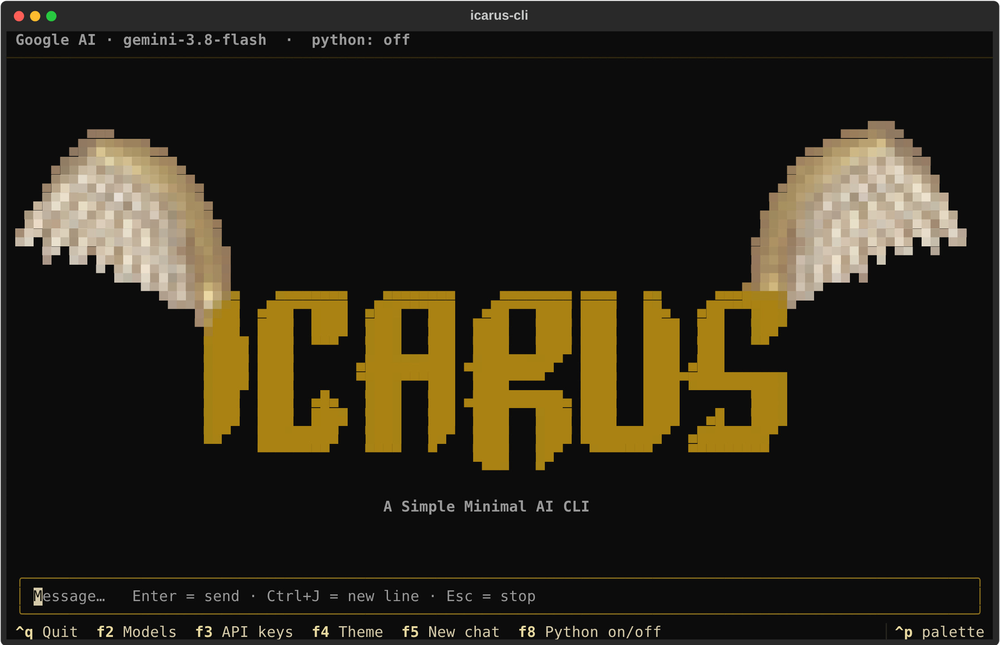

<p align="center">
  
</p>

<p align="center">A simple, minimal AI chat for your terminal.</p>

# Icarus CLI

Early build (alpha, version 0.1.3). Expect bugs and missing features.

<p align="center">
  
</p>

## What it can do:

- Chat with Gemini (Google AI), Inception Labs, NVIDIA and OpenRouter models from one terminal app
- Browse the live model list for your key, split into free and paid where the provider reports it
- Stream replies as they are generated, with a multi-line input box
- Switch themes, and set a name the model uses to address you
- Optionally let the model run Python code, off by default and only after you approve each run

## Requirements:

- Python 3.10 or newer (check with `python --version`)
- pip (comes with Python)
- A terminal with true color support (Windows Terminal, iTerm2, GNOME Terminal and most modern terminals)
- An API key for at least one provider:
  - Google AI: aistudio.google.com/apikey
  - Inception Labs: platform.inceptionlabs.ai/dashboard/api-keys
  - NVIDIA: build.nvidia.com/settings/api-keys
  - OpenRouter: openrouter.ai/keys

All Python dependencies (textual, httpx, keyring, PySide6-Essentials, google-genai) are installed automatically by pip.

## Setup and install:

1. Get the code:

```bash
git clone https://github.com/IcarusWinged/Icarus-CLI.git
cd Icarus-CLI
```

2. Create and activate a virtual environment (recommended):

```bash
python -m venv .venv
source .venv/bin/activate        # Linux and macOS
.venv\Scripts\activate           # Windows (PowerShell or cmd)
```

3. Install:

```bash
pip install .
```

4. Run:

```bash
icarus-cli
```

On first run, enter a name and add an API key for any one provider. Press F2 to pick a model, F3 to manage keys, and type /help for commands. Alternatively, set an environment variable instead of saving a key: GEMINI_API_KEY, INCEPTION_API_KEY, NVIDIA_API_KEY or OPENROUTER_API_KEY.

## Commands:

Type these in the chat box. Messages starting with / are never sent to a model.

| Command | What it does |
|---------|--------------|
| /help | Show the list of commands and shortcuts |
| /keys | Add, replace or clear API keys |
| /model | Pick the provider and model |
| /name | Change the name the model uses for you |
| /theme | Change the color theme |
| /new | Start a new chat (also /clear) |
| /python on, off, status | Let the model run Python code, with approval before every run |
| /run | Run the last Python code block the model wrote |
| /codebg none, translucent, opaque | Change the background of code blocks |
| /quit | Exit (also /exit) |

Shortcuts: F2 models, F3 API keys, F4 themes, F5 new chat, F8 Python on/off, Esc stop a reply, Ctrl+J new line, Ctrl+Q quit.

## A note on AI:

We are not against AI. Used well, it is a very good tool for learning, writing, coding and getting unstuck, and Icarus CLI exists because we think so. It is still a tool, not an authority: models can be wrong, out of date or confidently mistaken, so check anything that matters. Do not paste secrets, passwords or private data into a chat, and only approve generated code you understand before running it. Use it to support your own thinking, not to replace it.

## Warning: keyring on Linux:

API keys are stored in your operating system keyring. Some Linux setups (minimal installs, servers, containers, no desktop session) have no working keyring, and saving a key can fail. When no keyring exists, Icarus CLI warns you and falls back to a plain file with restricted permissions. You can also skip storage entirely and set an environment variable such as GEMINI_API_KEY.

## Roadmap:

- [ ] Chat history
- [ ] Chat memory
- [ ] More safety guardrails

## Star

If Icarus CLI is useful to you, give it a star on GitHub. It helps other people find the project and tells us the work is worth continuing.

<a href="https://www.star-history.com/?repos=icaruswinged%2Ficarus-cli&type=timeline&legend=bottom-right">
 <picture>
   <source media="(prefers-color-scheme: dark)" srcset="https://api.star-history.com/chart?repos=icaruswinged/icarus-cli&type=date&theme=dark&legend=bottom-right" />
   <source media="(prefers-color-scheme: light)" srcset="https://api.star-history.com/chart?repos=icaruswinged/icarus-cli&type=date&legend=bottom-right" />
   
 </picture>
</a>

## License

MIT. See the LICENSE file.
